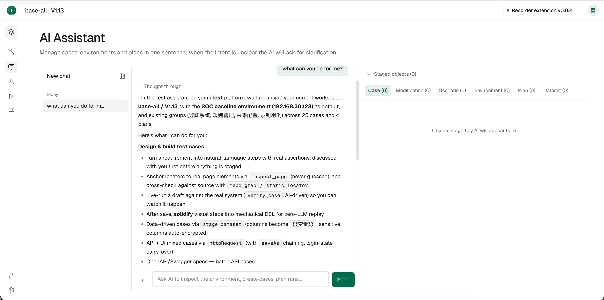
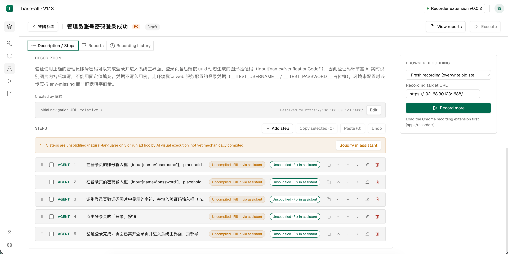
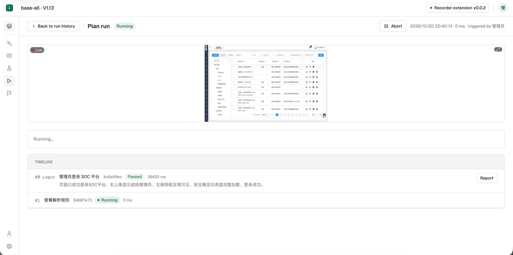

# iTest

**把回归测试，交给一个可控的 Agent。**

> [English](README.md) · 中文文档

AI-first 测试管理平台：用一句话管理用例、环境与计划。基于 [pi](https://github.com/badlogic/pi-mono) agent 框架的空间助手把「需求 → 用例 → 实测验证 → 固化 → 计划执行 → 归因」串成对话式工作流；同时保留传统页面（用例/计划/报告）供人工精修。

## 先读这篇文章

录制脚本一改就废，意图驱动又慢又飘，AI Coding 之后回归只能盲跑。这篇文章讲清了整套设计思路：意图驱动与机械指令双引擎，用例随版本自愈，版本变更按影响面自动筛选用例。

**[开源自动化回归测试，交给一个可靠的 Agent](https://mp.weixin.qq.com/s/kgM6LAq_zphtbBPu956v_w)**（微信公众号「失控之境」）—— 2026-10-20

## 界面截图

**AI 助手** —— 一句话说清需求，助手自己探查环境、把对象暂存等你确认，并说明它能做什么。



**用例编辑** —— 每个步骤都标着类型（`AGENT` / 机械），未固化的步骤就地标红，一眼看出哪些还没在真实浏览器里跑通。



**计划执行（实时）** —— 浏览器实时执行并带实时画面，timeline 逐条记录用例的结论与失败归因。



## 为什么是 iTest

回归自动化通常卡在这三道坎，iTest 对每个坎都给出了工程上的解：

| 行业痛点 | iTest 的回答 |
|---|---|
| 录制脚本，一改就废——脚本绑定页面结构与定位符，一次版本变更大批用例集体失效 | 用例先由 AI 在真实浏览器实测跑通，再 `solidify_case` 固化成机械 DSL 步骤；页面结构变化时用例随版本自愈重编，不必人工逐条修 |
| 意图驱动测试，慢且不可控——每一步都靠模型推理，速度与 token 成本双高，换个上下文行为就变 | 双模式回放：AI 只负责探索与验证，可机械回放的步骤固化后走 playwright-core 高速精准执行；机械步骤失败才按分类器降级 AI 临场兜底 |
| AI Coding 提速，覆盖却跟不上——提交频率成倍增长，测试资产更新仍靠人肉 | 需求 → 用例设计方法论内置在助手 system prompt（`reqDesign.ts`：正常流/边界/非法输入/状态流转/权限等维度逐一表态），repo 沙箱工具（`repo_read`/`repo_grep`/`static_locator`）让用例锚定真实源码，变更点不再靠人肉评估 |

## 产品特性

- **双模式回放**：AI 驱动（`aiTask`）与机械脚本（compiled DSL）双引擎，兼顾覆盖能力与运行效率
- **AI Native 工作台**：AI 助手贯穿用例生成、调试、执行与归因全流程，自然语言直达执行
- **数据驱动测试**：数据集（`/p/:projectId/datasets`）与用例参数绑定，一行数据一条场景
- **用例随版本自愈**：`verify_case` 真实浏览器逐步实测 + `solidify_case` 重编固化，机械 DSL 随页面结构变化自更新
- **覆盖设计内建**：需求进来先做覆盖设计（功能/异常/边界/安全/UIUX 逐维度表态，`reqDesign.ts` + `packages/shared/coverage.ts`），不臆造预期值
- **PC 与移动端全覆盖**：Web 走 playwright-core，iOS/Android 走 agent-device SDK，同一套平台管理

## 架构

Turborepo monorepo：

- `apps/api`：Node 22 + Express 5 + Drizzle + PostgreSQL + Redis（执行队列 worker + 计划调度器）
- `apps/web`：React 19 + Vite + Tailwind v4 + assistant-ui（端口 5173）
- `apps/recorder`：Chrome Manifest V3 扩展（Web 用例录制）
- `apps/api/src/pi`：空间助手后端 —— pi AgentSession、空间工具集（暂存/验证/固化/技能/MCP）、SSE 事件流
- `apps/api/src/execute`：执行引擎 —— playwright-core（Web）/ agent-device SDK（移动端）、AI 兜底降级、失败归因
- `packages/shared`：步骤 DSL + Zod schema + 回放工具
- `packages/ui`：设计令牌（`tokens.css`）+ 工具类

## 端口

| 服务 | 端口 |
|---|---|
| Web | 127.0.0.1:5173 |
| API | 127.0.0.1:54321 |
| PostgreSQL | 127.0.0.1:5432（容器 `itest-pg`） |
| Redis | 127.0.0.1:6379（容器 `itest-redis`） |

## 启动

```bash
cp .env.example .env   # 至少改 AUTH_JWT_SECRET / RECORDER_TOKEN_SECRET
pnpm install
pnpm dev   # docker compose 起 PG/Redis → drizzle migrate → turbo 并行起 web + api
```

访问 http://localhost:5173。种子账号 `admin/admin123`（首登强制改密）。

前提：本机装有 Docker（PG/Redis）与 Node 22 + pnpm 9。

## 核心流程

四步跑通回归：**接入需求 → 生成用例 → 执行验证 → 查看报告**。需求进来，报告出去，中间交给 iTest。

1. `/settings` 配置 LLM provider（mock / openai / anthropic / google，model 留空用 provider 默认）
2. `/` 项目 → 版本空间（`/p/:projectId/v/:versionId/…`）：AI 助手 / 用例 / 执行计划 / 执行历史 / 工作台
3. **AI 助手**：一句话建用例 → AI 把对象暂存（StagePanel）→ 人工勾选保存；`verify_case` 真实浏览器逐步实测（带实时画面），`solidify_case` 把可机械回放的步骤固化成 compiled 步骤；意图不明会先弹确认卡（confirm_request）再执行
4. 传统路径：用例详情「录制补充」（Chrome 扩展）、「AI 补充步骤」、「执行」；步骤可编辑、复制粘贴、撤销、失败重编
5. `/p/.../plans` 计划编排（关联用例 + 环境 + 定时调度）→ 执行历史含逐步截图与失败归因

## 空间助手（pi）

- **作用域**：线程按版本空间隔离（`workspacePath ≡ versionId`），左栏 ThreadList 支持切换/改名/删除/收缩。
- **工具集**（`apps/api/src/pi/space/tools/`）：inspect_page / announce_plan / manage_cases / manage_scenarios / manage_environments / manage_plans / verify_case / solidify_case / manage_skill / manage_mcp / query_history 等；另有 repo 沙箱工具 `repo_ls` / `repo_read` / `repo_grep` / `static_locator` / `repo_run`（`apps/api/src/repo.ts`）。
- **技能（skills）**：内容存磁盘目录树（容器 `skills/` 卷，DB 只留元数据），支持导入/编辑/脚本执行；发布前跑 `export-skills-to-disk.mjs` 导出。
- **推荐追问**：每轮回答落定后按线程转写生成 3 条追问建议。
- **图片附件**：composer 截图直接进对话（模型 `input` 须声明 `image`，网关别名模型漏声明会静默剥图）。
- **会话持久化**：AgentSession 是进程内存态（`SessionManager.inMemory()`）——重启 api 后历史线程列表为空属预期，DB 只存线程元数据与暂存对象。

## 用例执行（真实浏览器）

执行走 playwright-core 驱动本机 chromium（headless），逐步截图存到 `apps/api/screenshots/<reportId>/`。
chromium 二进制 **不会** 随 `pnpm install` 下载，需要本机已存在：

- `npx playwright install chromium`（缓存 `~/Library/Caches/ms-playwright` / `~/.cache/ms-playwright`）；或
- 设置 `CHROMIUM_PATH` 指向系统 chromium。

机械步骤失败时按分类器判定可降级 AI 临场执行（`aiTask`），降级结果回写报告；无浏览器时回退 mock 路径并在报告标注。

## Chrome 扩展加载

先 `pnpm --filter @itest/recorder build` 编译 modules/，再加载扩展：

1. 打开 `chrome://extensions/`
2. 开启「开发者模式」
3. 「加载已解压的扩展程序」 → 选择 `apps/recorder/` 目录

跨机器时把 `RECORDER_PUBLIC_WS_URL` 指向 API 端口（`ws://<host>:54321/recorder`）；ws 明文 + token 走 query，勿暴露公网。

## 移动端测试

支持 **iOS Simulator** 与 **Android Emulator**，基于 [agent-device](https://github.com/callstack/agent-device) SDK（`apps/api/src/execute/mobileEngine.ts`）。

- 设备目标：项目下 `/p/:projectId/device-targets`，按 mobileOs 区分，带 deviceRef 与 appBundleId 兜底。
- 用例 `platform='mobile'` 后执行自动路由 MobileEngine；报告 header 显示设备 pill。
- 手动验证：`node apps/api/probe-mobile.mjs`（`DRY_RUN=1` 仅打印请求序列）。
- 边界：暂不支持真机 / 云设备 / 屏幕录制。

## 测试与质量

```bash
pnpm verify  # lint + typecheck + test（web + api）
```

后端测试需要 Docker（testcontainers 起临时 PG）；apps/api 已固化 `TESTCONTAINERS_RYUK_DISABLED=true`。

## 部署

`infra/docker/`：`api.Dockerfile` / `web.Dockerfile`（nginx 反代 + WS 直通）/ `release.sh` + `deploy.sh`（镜像打包 → 远端加载 → 容器滚动 → smoke）。prod 迁移随 api 容器启动 `drizzle-kit push` 自动应用，无独立 migrate 步骤。skills 卷每次部署前自动 tar 备份。

## 已知边界

- 助手线程会话为内存态：api 重启后旧线程只剩元数据（列表按 `messageCount>0` 过滤后为空）
- 后台线程不流式：rail 的运行指示只对当前打开线程真实
- 上传文件：单个 ≤ 50MB，按 sha256 跨用例复用；多文件/拖拽不支持
- 密码加密：AES-256-GCM，密钥来自 `ENCRYPTION_KEY`（base64 32 字节），丢失即不可恢复
- 组件识别仅覆盖 AntD / Element / iView；多标签页录制只接管派生 tab
- 生产环境必须更换 `AUTH_JWT_SECRET` / `RECORDER_TOKEN_SECRET`，并配置 `ENCRYPTION_KEY`

## 贡献

欢迎通过 PR 贡献。`main` 分支受保护：合并前需要 **至少 1 个 approving review**，且所有对话需被解决。请先开 issue 讨论较大改动，避免白做。

- 提交前跑 `pnpm verify`（lint + typecheck + test）——后端测试需要 Docker（testcontainers 起临时 PG）
- 不要提交任何密钥/凭据：本地配置走 `.env`（参考 `.env.example`），`infra/docker/deploy.d/` 与 `infra/docker/.env.production` 已被 gitignore

## 许可证

本项目采用 [Apache License 2.0](LICENSE)。

`apps/api/scripts/skill-creator-content/` 是 Anthropic 官方 `skill-creator` 技能的逐字节拷贝，遵循其自带的 Apache-2.0 `LICENSE.txt`（该文件保留未改动），详情见 [NOTICE](NOTICE)。
